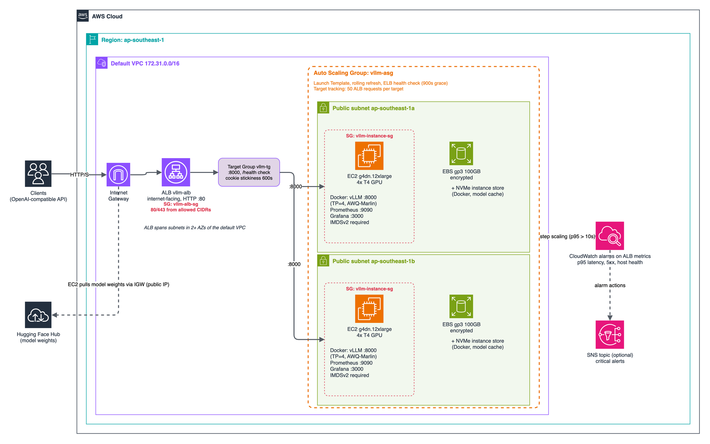

# vLLM on AWS

Self-hosted, OpenAI-compatible LLM endpoint on AWS. It serves Qwen2.5-32B-Instruct (AWQ, 4-bit) with [vLLM](https://github.com/vllm-project/vllm) on multi-GPU EC2 instances. The instances sit in an Auto Scaling Group behind an Application Load Balancer, and Terraform provisions all of it.



Editable source: [`docs/architecture.drawio`](docs/architecture.drawio). It is generated by `docs/build_drawio.py` and can also be edited by hand in draw.io.

## How it fits together

| Layer | AWS service | What it does here |
|-------|-------------|-------------------|
| Network | VPC (default), public subnets in 2+ AZs, Internet Gateway | Hosts the ALB and the GPU instances. Instances get public IPs, so there is no NAT gateway. |
| Entry point | Application Load Balancer, target group | Internet-facing on :80. Health check on `/health`, cookie stickiness (600s), 300s idle timeout for long generations. |
| Compute | EC2 `g4dn.12xlarge` (4x T4, 64 GB VRAM) | One vLLM container per instance, tensor parallel across all 4 GPUs. |
| Scaling | Auto Scaling Group, Launch Template | Target tracking on `ALBRequestCountPerTarget` (50) plus step scaling driven by a p95 latency alarm. Rolling instance refresh on template changes. |
| Storage | EBS gp3 (100 GB, encrypted), instance-store NVMe | EBS is the root volume. Docker and the model cache are moved to NVMe at boot because the AMI root volume is small. |
| Access control | Security groups, IMDSv2 | ALB SG takes 80/443. Instance SG takes :8000 from the ALB SG only, plus SSH, Grafana and Prometheus from configured CIDRs. |
| Observability | CloudWatch alarms, SNS (optional), Prometheus + Grafana | CloudWatch alarms cover p95 response time, 5xx, unhealthy hosts and healthy hosts below minimum. Prometheus and Grafana run on each instance and scrape vLLM `/metrics`. |
| Image | AWS Deep Learning OSS Nvidia Driver AMI (Ubuntu) | Ships with NVIDIA drivers, Docker and the container toolkit. |

### Request flow

1. A client calls `http://<alb-dns>/v1/chat/completions`.
2. The ALB forwards to a healthy target on :8000. Sticky cookies keep a session on one instance, which helps prefix caching.
3. vLLM batches requests continuously (`--max-num-seqs=512`) and streams tokens back.
4. If p95 target response time stays above 10s for 3 minutes, the step policy adds 1-2 instances. Request count per target above 50 triggers target tracking.

### Instance boot (`user-data.sh`)

1. Move Docker and containerd to the NVMe instance store.
2. Write the compose file and start `vllm/vllm-openai`. It downloads the model from Hugging Face on first start, which takes about 5 minutes.
3. Start Prometheus and Grafana from `/opt/monitoring`.

The ASG health-check grace period is 900s so instances are not killed while the model loads.

## Repo layout

| Path | Purpose |
|------|---------|
| `terraform/` | ALB, target group, launch template, ASG, scaling policies, CloudWatch alarms, security groups |
| `user-data.sh` | EC2 bootstrap (templated into the launch template) |
| `setup.sh` | Looks up the AMI, creates the key pair, checks the GPU vCPU quota, makes sure the VPC has 2+ AZ subnets, writes `terraform.tfvars` |
| `setup-cpu.sh`, `docker-compose.yml` | Local development and reference compose file |
| `healthcheck.sh` | Smoke test: health, models, one inference call, metrics |
| `perf-test.py`, `generate-report.py` | Load test (baseline, throughput, ramp, peak, streaming) and PDF report |
| `monitoring/` | Standalone Prometheus, Alertmanager and Grafana stack with a vLLM dashboard |
| `docs/` | Architecture diagram (`.drawio` and exported `.png`) |

## Deploy

Prerequisites: Terraform >= 1.5, AWS CLI with credentials, and a GPU vCPU quota ("Running On-Demand G and VT instances", quota code `L-DB2E81BA`) of at least 48 vCPUs per `g4dn.12xlarge`.

```bash
./setup.sh --region ap-southeast-1      # writes terraform/terraform.tfvars
cd terraform
terraform init
terraform apply
```

Wait about 5 minutes for the model to load, then:

```bash
./healthcheck.sh
curl http://<alb_dns_name>/v1/chat/completions \
  -H 'Content-Type: application/json' \
  -d '{"model":"qwen2.5-32b","messages":[{"role":"user","content":"Hello"}]}'
```

Tear down with `terraform destroy`. GPU instances bill by the hour, so do not leave this running.

### Key variables

| Variable | Default | Notes |
|----------|---------|-------|
| `aws_region` | `ap-southeast-1` | |
| `instance_type` | `g4dn.12xlarge` | `g5.12xlarge` (4x A10G) is faster but not available in ap-southeast-1 |
| `min_instances` / `desired_capacity` / `max_instances` | 1 / 1 / 1 | Raise `max_instances` to enable scale-out |
| `allowed_cidr_blocks` | `0.0.0.0/0` | Who can reach the ALB, Grafana and Prometheus |
| `ssh_cidr_blocks` | `0.0.0.0/0` | Restrict this to your IP |
| `sns_alert_arn` | empty | Set to receive alarm notifications |

## vLLM settings

| Flag | Value | Reason |
|------|-------|--------|
| `--tensor-parallel-size` | 4 | Shard the model across the 4 GPUs |
| `--quantization` | `awq_marlin` | 4-bit weights so a 32B model fits in 64 GB with room for KV cache |
| `--max-model-len` | 4096 | Keeps KV cache small enough for high concurrency |
| `--max-num-seqs` | 512 | Continuous-batching ceiling |
| `--gpu-memory-utilization` | 0.92 | |
| `--enable-prefix-caching` | on | Pairs with ALB stickiness |

T4 GPUs (compute capability 7.5) do not support Marlin kernels, so vLLM may fall back to plain AWQ on `g4dn`. Marlin applies on `g5`.

## Benchmark results

Measured on one `g4dn.12xlarge` (`perf-report.json`, full report in `vllm-performance-report.pdf`):

| Test | Concurrency | Tokens/s | p95 latency | Error rate |
|------|-------------|----------|-------------|------------|
| Baseline | 1 | 3.4 | 29 s | 0% |
| Throughput | 256 | 931 | 114 s | 12% |
| Streaming | 100 | 290 | 52 s | 0% |
| Peak | 1000 | 917 | 115 s | 75% |

One T4 node saturates at roughly 900 tokens/s. A single user sees about 3-4 tokens/s on this instance type, and above about 100 concurrent requests latency climbs sharply. For the 50-200 user target, run multiple instances (`max_instances` > 1) or move to `g5`.

## Monitoring

- **CloudWatch**: alarms are created by Terraform. Set `sns_alert_arn` for notifications.
- **Per instance**: Grafana on `:3000` and Prometheus on `:9090` (anonymous viewer access is enabled).
- **Central stack**: `monitoring/` has a compose file with Prometheus, Alertmanager, alert rules and a provisioned vLLM dashboard. Point `prometheus.yml` at your instance IPs.

## Known gaps

These are visible in the code and worth fixing before anything beyond a proof of concept:

- `user-data.sh` contains a hardcoded Hugging Face token, and the file is committed to git. Revoke that token, then read the new one from SSM Parameter Store or Secrets Manager through an instance role.
- `terraform/*.tfstate.*.backup` files are tracked in git even though `.gitignore` lists them. Remove them from the index and use an S3 backend with state locking.
- The stack uses the default VPC, and instances have public IPs. A custom VPC with private subnets for the instances, public subnets for the ALB and a NAT gateway is the next step.
- The ALB listens on HTTP only. Add an ACM certificate and an HTTPS listener.
- SSH, Grafana and Prometheus default to `0.0.0.0/0`. Restrict the CIDRs and prefer SSM Session Manager over SSH.
- Grafana ships with the default `admin` password.
- The vLLM image is pinned to `latest`.

## License

Apache 2.0, see [LICENSE](LICENSE).
